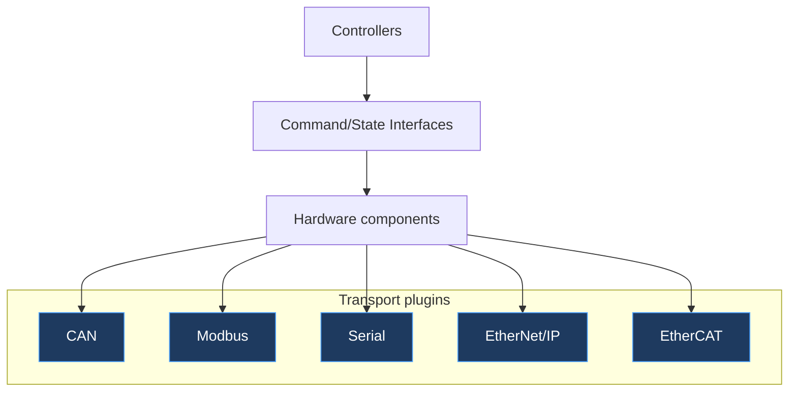

# Transport Plugins

## Short Description

This proposal aims to define "transports" or "comms" as a first class concept in ros2_control. The core idea is define a shared base class for transports, have the resource manager load each defined transport plugin from the URDF and hand them to the hardware components when they are initialized.

Internally, we've built a fairly flexible system for integrating arbitrary fieldbus devices. One thing we rely on is a singleton for hardware components to share resources between each other. 

There has been some conversation around this idea in the past and some drivers solving the same problem:

* https://github.com/ros-controls/ros2_control/issues/1956
* https://github.com/ros-controls/ros2_control/issues/2811
* https://github.com/Duatic/ethercat_sdk_master/blob/master/include/ethercat_sdk_master/EthercatMasterSingleton.hpp#L12

Today we use a `system` plugin to wrap our hardware components with the singleton context. But this is very much not the intended purpose of a `system` plugin.

What we do is decouple the transport from the hardware component, allowing the same transport drivers to be reused (for example using a base socketcan driver with CANopen and J1939 hardware components).




## User Perspective

Basically you can define a `transport` using a ros2_control tag in the URDF. The resource manager loads the transport plugin and makes it available to hardware components. A transport block could also be used to declare the transports that the hardware component relies on. 

```xml
  <!-- ============================================================
       Define a transport for the CAN bus.
       ============================================================ -->
  <ros2_control name="can0" type="transport">
    <plugin>socketcan_transport/SocketCanTransport</plugin>
    <param name="interface">vcan0</param>
  </ros2_control>

  <!-- ============================================================
       Referenced int the hardware component as `transport`.
       ============================================================ -->
  <ros2_control name="left_motor" type="actuator">
    <hardware>
      <plugin>ros2_control_transport_demo/TransportDemoActuator</plugin>
      <param name="arbitration_id">0x201</param>
    </hardware>
    <transport name="can0" />
    <joint name="left_wheel_joint">
      <command_interface name="velocity"/>
      <state_interface name="position"/>
    </joint>
  </ros2_control>

  <ros2_control name="right_motor" type="actuator">
    <hardware>
      <plugin>ros2_control_transport_demo/TransportDemoActuator</plugin>
      <param name="transport">can0</param>
      <param name="arbitration_id">0x202</param>
    </hardware>
    <transport name="can0" />
    <joint name="right_wheel_joint">
      <command_interface name="velocity"/>
      <state_interface name="position"/>
    </joint>
  </ros2_control>

```

Hardware component would also not be required to do this for backward compatibility.

## Key Advantages

* Testability - hardware components and their logic can be decouple from the transport / hardware access, making testing easier
* Better semantics on communication interfaces
* Better insight into issues (issue with the hardware component or the transport)

## Open Discussion / Things to think about

* Deactivating a transport would invalidate a hardware component, so they'd have to be lifecycle transitioned together
* Is this only applicable to CAN bus?
  * No. We use this methodology for CAN, MODBUS, EtherNet/IP and Serial devices
  * A perhaps niche use case for modbus was a shared connection where different hardware components were using different sets of registers

## Demo

I have a working demo [here](https://github.com/nnarain/ros2_control_transport_demo/tree/develop). See ros2_control feature branch here: https://github.com/nnarain/ros2_control/tree/feat/transport-plugins

(the above demos use AI assisted code, `deepseek-v4-flash`)

